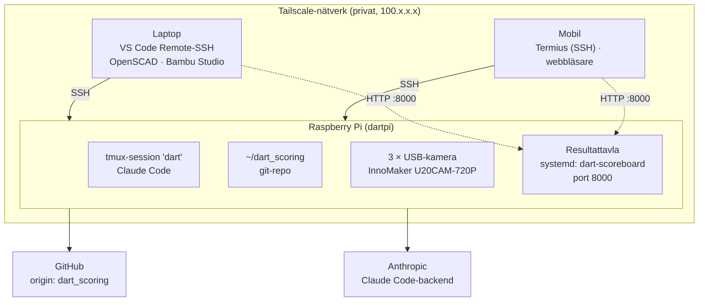

# Utvecklingsmiljö – arkitektur

Det här dokumentet beskriver hur utvecklingsmiljön för dartpoängräknaren är uppsatt: vilka enheter som ingår, vad som körs var och hur de hänger ihop.

## Översikt

Raspberry Pi:n är navet. All kod, all körning och kodagenten (Claude Code) finns på Pi:n. Laptopen och mobilen är fönster in mot den via SSH. Alla enheter är kopplade via ett privat Tailscale-nätverk, så samma uppsättning fungerar både hemma och borta.



## Komponenter

### Raspberry Pi (`dartpi`)

- **OS:** Raspberry Pi OS, 64-bit (`aarch64`).
- **Kod:** `~/dart_scoring`, den enda arbetskopian av repot. Remote: `git@github.com:zekesimonsson/dart_scoring.git` (SSH, med nyckeln `~/.ssh/id_ed25519` registrerad på GitHub).
- **Kodagent:** Claude Code, installerat med den officiella installern i `~/.local/bin` (som ligger i `PATH` via `~/.bashrc`). Agenten körs i tmux-sessionen `dart` så att den fortsätter arbeta när ingen är ansluten.
- **Kameror:** 3 × InnoMaker U20CAM-720P (USB/UVC, OV9732, 1280×720, 102° horisontell / 120° diagonal bildvinkel), anslutna direkt till Pi:ns USB-portar.
- **Resultattavla:** webbservern (`web_server.py`) körs som systemd-användartjänsten `dart-scoreboard` på port 8000. Den startar automatiskt när Pi:n startar (linger är påslaget för `pi`) och startas om om den kraschar. Nås från alla enheter i Tailscale-nätverket på `http://dartpi:8000/` (eller `http://100.107.2.73:8000/`). Sidan har ingen inloggning, så den ska inte exponeras utanför Tailscale.
- **Nätverk:** Tailscale, startar automatiskt (`tailscaled`), nyckelns utgångsdatum avstängt.

### Laptop

- **VS Code med Remote-SSH:** öppnar `~/dart_scoring` direkt på Pi:n, så att man redigerar samma filer som agenten.
- **Terminal:** `ssh pi@dartpi` följt av `tmux attach -t dart` för att följa eller styra agenten.
- **3D-design:** OpenSCAD (kamerahållarna är parametriska `.scad`-filer) och Bambu Studio för utskrift på Bambu Lab A1.
- **Tailscale.**

### Mobil

- **Termius** för SSH mot `dartpi`, sedan `tmux attach -t dart`.
- **Webbläsare** för resultattavlan på `http://dartpi:8000/`.
- **Tailscale-appen**, måste vara påslagen för att nå Pi:n utanför hemmanätverket.
- Används för korta insatser: kolla läget, ge agenten nya uppgifter, godkänna ändringar.

### Externa tjänster

| Tjänst | Roll |
|---|---|
| GitHub | Backup och historik för koden |
| Anthropic | Backend för Claude Code (inloggad med jobbkonto) |
| Tailscale | Koordinerar anslutningar mellan enheterna. Trafiken går direkt mellan dem när det går (t.ex. hemma), annars via Tailscales krypterade reläservrar (t.ex. från mobilnät) |

## Vanliga arbetsflöden

**Ansluta till agenten (från laptop eller mobil):**

```bash
ssh pi@dartpi
tmux attach -t dart
```

Koppla loss utan att stänga: `Ctrl+b` sedan `d`.

**Efter omstart av Pi:n** (tmux-sessionen försvinner, allt annat finns kvar; resultattavlan startar av sig själv):

```bash
tmux new -s dart
cd ~/dart_scoring
claude
```

**Resultattavlan:**

```bash
systemctl --user status dart-scoreboard    # körs den?
systemctl --user restart dart-scoreboard   # efter ändringar i serverkoden
tail -f ~/dart_scoring/logs/web_server.log # följ loggen
```

Starta inte `python3 web_server.py` för hand samtidigt, eftersom båda vill använda port 8000.

**Spara arbete:**

```bash
git add -A
git commit -m "Beskrivning"
git push
```

## Kända risker

- **SD-kortet** är den enda platsen där okommittad kod finns. Committa och pusha ofta.
- **Pi:n måste vara igång** för att något ska fungera. En omstart kräver att tmux och Claude Code startas igen. Pågående spel på resultattavlan finns bara i minnet och nollställs vid omstart av Pi:n eller tjänsten.
- **Samtidiga ändringar:** redigera inte samma fil i VS Code medan agenten arbetar i den.
- **Jobbkontot:** Claude Code är inloggat med ett jobbkonto där organisationens policy gäller (Remote Control är t.ex. avstängt). Byts kontot: `/logout` i Claude Code och logga in med det nya.
