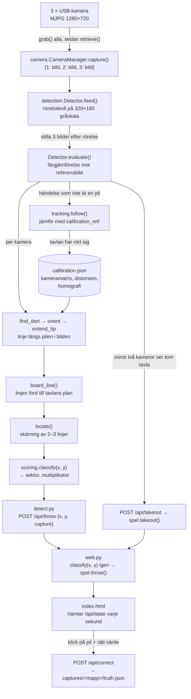

# Systembeskrivning – automatisk dartpoängräkning

Teknisk sammanfattning av vad koden gör, skriven utifrån källkoden per 2026-11-17. Alla tal och namn nedan är de som står i koden; konstantnamn anges inom `kod`.

## Översikt

En Raspberry Pi 4 med tre USB-kameror runt tavlan ser varje pil. När en pil har landat jämförs bilderna med hur tavlan såg ut innan. I varje kamera passas en linje längs pilen. Linjerna förs över till tavlans plan med kalibreringen, och där de skär varandra sitter spetsen. Positionen översätts till sektor och multiplikator och skickas till en webbserver som håller spelet (X01, Cricket, Killer, Shanghai eller Around the Clock) och visar resultattavlan i webbläsaren. Tavlan vrider sig lite när pilar dras ut, så avkänningen kontrollerar efter varje utdragning om tavlan har rört sig och uppdaterar då kalibreringen själv.

Tre program körs:

| Program | Roll | Port |
|---|---|---|
| `web_server.py` | Resultattavla och spellogik (systemd-tjänsten `dart-scoreboard`) | 8000 |
| `detect.py` | Pilavkänning, skickar pilar och utdragningar till resultattavlan, följer tavlans läge | – |
| `calibrate.py` | Kalibreringsverktyg, används när en kamera flyttats | 8001 |

`detect.py` och `calibrate.py` håller båda kamerorna och kan inte köras samtidigt. Utöver dessa startar systemd-tjänsten `dart-tmux` en tmux-session med utvecklingsverktyget vid uppstart; den påverkar inte själva systemet.

## 1. Arkitektur

### Moduler och filer

**Paketet `dart_scoring/`**

| Fil | Vad den gör |
|---|---|
| `camera.py` | `CameraManager` öppnar de tre kamerorna via fasta sökvägar under `/dev/v4l/by-path/` (`CAMERA_PATHS`), så kamera-id 1–3 är knutna till USB-hubbens portar 2–4, inte till `/dev/videoN`. `configure()` ställer in MJPG 1280×720 i 30 bilder/s, manuell exponering 20 ms (`EXPOSURE = 200` i enheter om 100 µs, en multipel av 10 ms mot LED-flimmer på 50 Hz), förstärkning 0 och fast vitbalans 3050 K (`WB_TEMPERATURE`). Automatisk vitbalans flyttade färgerna i en hel kamerabild under spel, så att den tomma tavlan inte kändes igen. `capture()` anropar först `grab()` på alla kameror och sedan `retrieve()`, så att de tre bilderna tas så samtidigt som möjligt. |
| `calibration.py` | Kameramodell per kamera: bildpixel → normaliserade tavelkoordinater. Passning från klickade referenspunkter (linsdistorsion + homografi), avbildning åt båda hållen (`image_to_board`, `board_to_image`), ritning av tavlan över en bild, hitta felklickade punkter (`find_suspects`), läsa/skriva `calibration.json`. |
| `calibration_web.py` + `static/calibrate.html` | Webbgränssnittet för kalibreringen: tar bilder från kamerorna, visar live-MJPEG (640×360), tar emot klickade punkter, passar modellen och sparar. Bilden som punkterna klickades på sparas som referensbild i `calibration_ref/cam<N>.jpg`, tillsammans med modellen i det ögonblicket. |
| `tracking.py` | Följer tavlan efter kalibreringen (avsnitt 4.4): jämför en bild av tavlan med referensbilden, räknar ut hur tavlan har vridits eller flyttats och ger en uppdaterad modell. `remap()` flyttar en bild med tavlan. |
| `detection.py` | Pilavkänningen: tillståndsmaskinen `Detector` (rörelse → stillhet → utvärdering), bildjämförelse, linjepassning per kamera, sammanvägning av kamerorna till en punkt på tavlan, och debugbilder (`draw_event`). |
| `scoring.py` | `classify(x, y)`: punkt i tavelkoordinater → (sektor, multiplikator). `SEGMENTS` är sektorernas ordning medurs från 20. |
| `game.py` | Gemensam grund för alla spel (`TurnGame`): spelare, turer om 3 pilar, rättning av en pil, utdragning, ångra och vyn som resultattavlan visar. `X01Game` (även `Game`): X01 med bust och double out. |
| `games.py` | `CricketGame`, `AroundTheClockGame`, `ShanghaiGame`, `KillerGame` och `new_game()`, som startar ett spel efter namn. |
| `web.py` + `static/index.html` | HTTP-server (enbart standardbiblioteket) med ett delat spel bakom ett lås, JSON-API och resultattavlan som en sida i ren HTML/JS som hämtar `/api/state` varje sekund. |

**Skript i roten**

| Fil | Vad den gör |
|---|---|
| `detect.py` | Huvudloop för avkänningen: läser kalibreringen, öppnar kamerorna, kastar 15 bilder medan exponeringen sätter sig, kontrollerar tavlans läge mot referensbilderna (`follow_board`), tar bilden som tom tavla och matar sedan `Detector.feed()` med varje bilduppsättning. Pilar skickas till `/api/throw`, utdragning till `/api/takeout`. Efter varje händelse som inte är en pil kontrolleras tavlans läge igen. Med `--save` sparas före/efter/debugbilder och `event.json` per händelse i `captures/`. |
| `calibrate.py` | Startar kalibreringsverktyget. |
| `web_server.py` | Startar resultattavlan, med loggning till fil som roteras vid 1 MB. |
| `evaluate_captures.py` | Kör nuvarande avkänningskod på sparade bilder för pilar som rättats på resultattavlan (de har en `truth.json`) och räknar hur många som blir rätt. |
| `main.py` | Skriver ut poängen för några hårdkodade punkter (ingen hårdvara behövs). |
| `test_camera.py`, `test_cameras.py` | Manuella hårdvarutester som tar en bild från en respektive alla kameror. |
| `systemd/dart-scoreboard.service` | systemd-användartjänst som startar `web_server.py` vid uppstart och startar om den om den kraschar. |
| `systemd/dart-tmux.service` | systemd-användartjänst som skapar tmux-sessionen `dart` vid uppstart. |
| `tests/` | Enhetstester (pytest, 218 st). Avkännings- och följningstesterna använder tre syntetiska vidvinkelkameror, renderade pilar och en syntetiskt vriden tavla. |

### Dataflöde från kamerorna till poängen

Koordinatsystemet på tavlan är normaliserat: origo i bullen, radie 1,0 = ytterkanten på dubbelringen (170 mm), negativ y uppåt mot 20.

`detect.py` skickar koordinaterna, inte poängen; resultattavlan klassificerar själv med samma `classify`. Om resultattavlan inte svarar inom 3 s loggas en varning och pilen går förlorad för spelet (den finns kvar i loggen).

## 2. Externa bibliotek

Projektet har ingen `requirements.txt`; allt installeras som Debian-paket i systemets Python (ingen virtualenv). Versioner enligt `dpkg` och modulernas `__version__` på Pi:n:

| Bibliotek | Version | Används till |
|---|---|---|
| Python | 3.13.5 | Körmiljö |
| OpenCV (`cv2`, paketet `python3-opencv`) | 4.10.0 | Kamerainläsning via V4L2 (`VideoCapture`, MJPG-avkodning); bildbehandling (`GaussianBlur`, `resize`, `absdiff`, `subtract`, `dilate`/`erode`, `threshold`, `morphologyEx`, `connectedComponentsWithStats`, `fitLine`, `fillPoly`, `remap`); kalibrering (`calibrateCamera`, `findHomography`, `undistortPointsIter`, `projectPoints`, `perspectiveTransform`); följning av tavlan (`ORB_create`, `BFMatcher`, `findHomography` med RANSAC); JPEG-kodning för sparade bilder och kalibreringsverktygets ström; ritning av debugbilder |
| NumPy (`python3-numpy`) | 2.2.4 | Matriser och vektorräkning: linjer, minsta kvadrat-skärning (`linalg.lstsq`), Jacobian och SVD för mm per pixel, kameraposition ur homografin |
| pytest (`python3-pytest`) | 8.3.5 | Endast enhetstesterna |

Från standardbiblioteket: `http.server` (`ThreadingHTTPServer`) för båda webbservrarna, `urllib.request` för anropen från `detect.py` till resultattavlan, `json`, `threading`, `logging` (med `RotatingFileHandler`), `argparse`, `dataclasses`, `copy` (ångra-historiken och turens startläge), `random` (Killers nummer), `re`, `math`, `pathlib`, `datetime`.

Webbsidorna laddar inga externa skript eller stilmallar.

## 3. Hur träffpunkten detekteras

### 3.1 Kalibrering

Kalibreringen görs en gång per kamera i `calibrate.py` och sparas i `calibration.json`.

1. Användaren klickar referenspunkter i varje kameras bild: där en ringkant (`RINGS`: dubbel ytter/inner, trippel ytter/inner, yttre bull, bullseye) korsar en sektorgränstråd (gräns 0–19, 0 = tråden mellan 20 och 1), eller bullens mitt. Varje etikett har en känd position på tavlan (`reference_point`), vinkel `9 + 18·gräns` grader medurs från 20.
2. `fit()`, med minst 12 punkter (`MIN_DISTORTION_POINTS`): `cv2.calibrateCamera` med tavelpunkterna som ett plant objekt (z = 0) i en enda vy. Startgissning brännvidd 0,8 × bildbredden, huvudpunkten i bildens mitt. Flaggor: startgissning används, fast bildförhållande, ingen tangentiell distorsion, k3 = 0. Kvar blir kameramatrisen och radiell distorsion k1, k2 (vidvinkellinserna har k1 ≈ −0,47).
3. De klickade pixlarna avdistorderas (`cv2.undistortPointsIter`, 50 iterationer) och en homografi passas med `cv2.findHomography` (vanlig minsta kvadrat, ingen RANSAC) från avdistorderade normaliserade bildkoordinater till tavelkoordinater.
4. Med 4–11 punkter passas bara en homografi direkt på pixlar. Under 4 punkter sparas bara punkterna.
5. Restfel per punkt räknas både i mm på tavlan och i pixlar och visas i verktyget. `find_suspects()` hittar felklickade punkter: varje punkt kontrolleras mot en modell passad utan den, och missar den med mer än max(20 px, 3 × medianmissen) kontrolleras den igen mot en modell utan alla sådana kandidater. Verktyget föreslår den etikett som modellen lägger närmast klicket.
6. Bilden som punkterna klickades på sparas som referensbild (`calibration_ref/cam<N>.jpg`), och modellens homografi och punkter i det ögonblicket sparas som `reference` i kamerans post. Det är utgångsläget när tavlan följs (avsnitt 4.4).

`image_to_board(modell, u, v)` = avdistordera pixeln, tillämpa homografin. `board_to_image` gör det omvända.

### 3.2 Bildbehandling per kamera

När en utvärdering körs (se avsnitt 4) gör `Detector.evaluate()` följande för varje kamera:

1. **Utjämning:** färgbilden suddas med Gauss 5×5 (`to_blurred`). Jämförelsen sker i färg och inte gråskala, eftersom stålspetsen över den gröna ringen är ungefär lika ljus som det gröna.
2. **Ändringsmask** (`change_mask`) mot referensbilden (tavlan efter förra händelsen):
   - För att tåla att kameran skakar vid träffen räknas en pixel bara som ändrad om den ligger utanför spannet av referensbildens värden inom `SHIFT_PX = 2` pixlar: `max(efter − dilate(före), erode(före) − efter)` med en 5×5-kärna, per färgkanal.
   - Största ändringen av de tre kanalerna tas, tröskel `> 25` (`CHANGE_PIXEL`).
   - Masken begränsas till området där en pil kan synas (`board_mask`): en cirkel med radie 1,2 (204 mm) förd in i bilden med kalibreringen, utökad 320 pixlar uppåt (`MASK_UP_PX`) för skaft och fjädrar.
   - Morfologisk öppning 3×3 (tar bort brus) och stängning 7×7 (fyller hål).
3. **Linje längs pilen** (`find_dart`):
   - Sammanhängande områden mindre än 25 pixlar (`MIN_COMPONENT`) kastas. Är färre än 150 pixlar kvar (`MIN_DART_PIXELS`) ser kameran ingen pil.
   - Högst 20 000 pixlar (slumpvis urval) används. En linje passas med `cv2.fitLine` (Huber), pixlar längre än 30 px från linjen (`REFINE_PX`) tas bort och linjen passas om; detta görs två gånger.
   - Linjens riktning vänds så att den pekar nedåt i bilden. Längs linjen klipps upp till 0,5 % av pixlarna, men högst 15 (`TIP_TRIM_PIXELS`), bort i varje ände mot ströpixlar. Nedre änden blir den synliga spetsen, övre änden toppen.
   - Förhållandet längd/bredd (bredd = 2 × 95:e percentilen av avståndet från linjen) måste vara minst 2,5 (`MIN_ELONGATION`), annars är det inte en pil.
4. **Riktningskontroll** (`orient`): ur homografin räknas kamerans läge relativt tavlan ut (`camera_pose`), och därmed åt vilket håll i bilden en pil som sticker rakt ut ur tavlan vid spetsen pekar (`dart_axis`, mätt mellan tavlan och 0,2 radier = 34 mm ut). Avviker linjen mer än 35° (`MAX_AXIS_ANGLE`) från den riktningen räknas kameran bort. Pekar linjen åt fel håll byts spets och topp.
5. **Förlängning av spetsen** (`extend_tip`): ändringsmasken med skaktolerans tappar ofta den tunna spetsen där den korsar en tråd eller en färggräns. Från spetsen följs linjen upp till 30 pixlar längre (`TIP_SEARCH_PX`) i en remsa ±4 pixlar bred, med vanlig färgskillnad utan skaktolerans. Spetsen flyttas till sista steget där skillnaden är `> 25`; upp till 3 steg i rad utan skillnad (`TIP_SEARCH_GAP`) tolereras.

### 3.3 Linjen på tavlans plan

Pilens linje i en kameras bild ligger i ett plan genom kameran och pilen. Det planet skär tavlan längs en linje som går genom punkten där pilen sitter, även om själva spetsen inte syns. `board_line()` för över:

- **punkt:** den synliga spetsen, avbildad på tavlan;
- **riktning:** från spetsen mot pilens mittpunkt, avbildad på tavlan (mitten och inte toppen, eftersom toppen på en pil långt bort kan hamna ovanför tavelplanets horisont i bilden);
- **skärpa:** `mm_per_pixel`, hur många mm på tavlan en pixel täcker vid spetsen, i sin grövsta riktning (största singulärvärdet av avbildningens Jacobian).

### 3.4 Hur de tre kamerorna kombineras (`locate`)

Indata är en linje per kamera som såg pilen.

1. **Alla tre linjerna:** om tre linjer finns och största vinkeln mellan två av dem är minst 12° (`MIN_LINE_ANGLE`) beräknas en minsta kvadrat-skärning. Ligger alla tre linjerna inom 8 mm (`LINE_TOLERANCE_MM`) från punkten används den (metod "skärning 1+2+3").
2. **Bästa paret:** annars prövas varje par av linjer som möts med minst 12°. Paret vars skärning ligger närmast den bästa synliga spetsen (`best_tip`) väljs, om skärningen ligger högst 40 mm därifrån (`MAX_TIP_OFFSET_MM`).
   - Bästa synliga spets: med en eller två kameror ett medelvärde viktat med 1/(mm per pixel)², så den kamera som ser skarpast väger tyngst; med tre kameror den spets som har minst sammanlagt avstånd till de andra.
   - **Skarp-spets-regeln:** möts paret med under 20° (`SHARP_TIP_ANGLE`), ser den ena kameran minst 3 gånger skarpare (`SHARP_TIP_RATIO`) och hamnar skärningen bakom den skarpa kamerans synliga spets (på skaftets sida, där spetsen inte kan vara) används den skarpa kamerans spets i stället (metod "spets N"). Framför spetsen accepteras skärningen, eftersom den tunna spetsen ofta inte syns mot tavlan.
3. **Ingen användbar skärning:** den bästa synliga spetsen används direkt (metod "spets …"). Så blir det också när bara en kamera såg pilen.

I alla skärningar drar dessutom varje kameras synliga spets svagt i punkten: en extra ekvation per kamera med vikten 0,02 × (0,5 / mm per pixel)² (`TIP_WEIGHT`, `TIP_REFERENCE_MM_PER_PX`). Den spelar bara roll längs nästan parallella linjer, där skärningen är dåligt bestämd, och då avgör den kamera som är närmast pilen.

Resultatet förkastas (händelsen blir oklar) om:

- det ligger längre än 1,35 radier (230 mm, `MAX_RADIUS`) från mitten; där kan ingen pil sitta;
- det bygger bara på synliga spetsar (metod "spets …") och ligger utanför dubbelringen (`MAX_TIP_ONLY_RADIUS = 1,0`). En hand i kanten av en kameras bild ser ut så och skulle annars kosta spelaren en pil som miss; en riktig pil där ger ändå inga poäng, och utdragningen fyller turen med missar.

**Känd begränsning:** en pil som sitter nära linjen mellan två kameror (t.ex. längst ner mellan kamera 1 klockan 8 och kamera 2 klockan 4) ger två nästan parallella linjer. Då måste den tredje kameran se pilen för att positionen ska bli säker.

### 3.5 Från position till sektor och poäng (`scoring.classify`)

Med r = avståndet från mitten (normaliserat, ringmått i mm / 170):

| Villkor | Resultat |
|---|---|
| r > 1,0 | Miss (0, 0) |
| r ≤ 6,35/170 | Bullseye (25, ×2) = 50 |
| r ≤ 15,9/170 | Yttre bull (25, ×1) = 25 |
| 99/170 ≤ r ≤ 107/170 | Trippel |
| 162/170 ≤ r ≤ 1,0 | Dubbel |
| annars | Singel |

Sektorn: vinkeln medurs från 20, `atan2(x, −y)` i grader, ger index `⌊(vinkel + 9) / 18⌋ mod 20` i `SEGMENTS = [20, 1, 18, 4, 13, 6, 10, 15, 2, 17, 3, 19, 7, 16, 8, 11, 14, 9, 12, 5]`. Poängen är sektor × multiplikator.

## 4. Ny pil, utdragning och tavlans läge

### 4.1 Tillstånd i `Detector`

| Fält | Betydelse |
|---|---|
| `reference` | Utjämnad bild per kamera av tavlan efter senaste händelsen |
| `empty` | Utjämnad bild per kamera av den tomma tavlan |
| `empty_known` | Per kamera: mask över de pixlar i `empty` som fortfarande är kända efter att den tomma tavlan flyttats med en vriden tavla (tom = alla kända) |
| `empty_change` | Antal ändrade pixlar mot den tomma tavlan efter senaste händelsen |
| `leftover` | Någon kamera såg en ändring mot den tomma tavlan vid senaste händelsen (t.ex. en miss som blev oklar) |
| `moving`, `still` | Om rörelse setts sedan senaste utvärderingen, och antal stilla bilder i rad |
| `darts` | Pilar i tavlan sedan senaste utdragningen |
| `last_dart` | Tid och position för senaste pilen (mot dubbelräkning) |
| `last_event_time` | Tid för senaste utvärdering eller uppdatering av referensen |

När `detect.py` startar tas en bilduppsättning som både referens och tom tavla (`reset`), så tavlan måste vara tom då.

Något sitter i tavlan (`_occupied`) om `darts > 0` eller `leftover` är satt.

### 4.2 Rörelse och stillhet (`feed`, varje bilduppsättning)

1. Varje bild skalas ned till 320×180 gråskala och suddas med Gauss 3×3.
2. Absolut skillnad mot föregående nedskalade bild, inom tavelmasken. En pixel med skillnad `> 15` (`MOTION_PIXEL`) räknas som rörelse. Rör sig mer än 0,2 % av maskens pixlar (`MOTION_FRACTION`) i någon kamera är det rörelse.
3. Rörelse: `moving = True`, `still = 0`.
4. Ingen rörelse: `still` ökas. Har det rört sig och varit stilla 3 bilder i rad (`STILL_FRAMES`) körs `evaluate()`. Avkänningen hinner med ungefär 8 bilduppsättningar per sekund (MJPG-avkodningen av tre bilder tar ~38 ms), så det motsvarar ungefär 0,4 s stillhet.
5. Har ingenting rört sig och det gått mer än 10 s (`REFRESH_SECONDS`) sedan senaste händelsen uppdateras referensen (`_refresh`), om ingen kamera har 150 eller fler ändrade pixlar mot den. Så följer avkänningen långsamma ljusförändringar. Sitter inget i tavlan uppdateras även den tomma tavlan.

### 4.3 Utvärdering (`evaluate`)

Ändringsmasken (avsnitt 3.2) räknas mot referensen per kamera. Mot den tomma tavlan räknas den per kamera med `empty_change_mask`, som är mer tolerant eftersom den tomma tavlan kan vara timmar gammal: varje färgkanal i den tomma tavlan skalas så att dess median över tavlan stämmer med den nya bilden, och en förskjutning på upp till 6 pixlar tolereras (`EMPTY_SHIFT_PX`), eftersom tavlan sätter sig några pixlar under de första pilarna. En kamera ser tom tavla om den har färre än 150 ändrade pixlar (600, `MOVED_EMPTY_PIXELS`, om den tomma tavlan har flyttats med en vriden tavla). Tavlan ser tom ut när minst två kameror ser tom tavla (`EMPTY_VOTES`), så att en kamera med avvikande bild inte ensam kan blockera en utdragning.

Besluten tas i den här ordningen:

| Steg | Villkor | Händelse | Följd |
|---|---|---|---|
| 1 | Färre än 150 ändrade pixlar i varje kamera | `none` | Ingenting; referensen behålls (t.ex. en hand som rörde sig och försvann) |
| 2 | Något sitter i tavlan och tavlan ser tom ut | `takeout` | `darts = 0`, den tomma tavlan tas om; `detect.py` skickar `/api/takeout` |
| 3 | Pilar finns och ändringen mot tomma tavlan har minskat med mer än hälften av ändringen mot referensen | `removed` | En pil drogs ut; `darts` minskas, inget skickas |
| 4 | Någon kamera har mer än 10 % av bilden ändrad (`MAX_DART_FRACTION`, 92 160 pixlar) | `unclear` | Inte en enskild pil (t.ex. en person framför tavlan); en pil alldeles intill en kamera täcker 5–8 %, en person 13–30 %; inget skickas |
| 5 | Ingen kamera ger en godkänd linje, eller positionen förkastas (avsnitt 3.4) | `unclear` | Inget skickas |
| 6 | Positionen ligger inom 15 mm (`DUPLICATE_MM`) från förra pilen och mindre än 1,5 s (`DUPLICATE_SECONDS`) efter den | `duplicate` | Samma pil som sätter sig efter träffen; inget skickas |
| 7 | Annars | `dart` | Position och poäng räknas ut, `darts` ökas, `detect.py` skickar `/api/throw` |

Vid alla händelser utom `none` blir de nya bilderna referens, så nästa pil jämförs med tavlan inklusive tidigare pilar.

### 4.4 Tavlan följs (`tracking.py`, `detect.follow_board`)

Tavlan vrider sig lite när pilar dras ut. Vid start av `detect.py` och efter varje händelse som inte är en pil (`takeout`, `removed`, `unclear`, `duplicate`) kontrolleras för varje kamera om tavlan har rört sig sedan kalibreringen (`tracking.follow`):

1. ORB-detaljer (högst 4000, `FEATURES`) hittas på tavlan ut till 1,15 radier (`FEATURE_RADIUS`) i referensbilden och i den nya bilden, och paras ihop.
2. Tavlan är plan, så i avdistorderade bildkoordinater är förflyttningen exakt en homografi W. Den passas med RANSAC (tolerans 1,5 px).
3. Matchningen godtas bara med minst 80 överensstämmande detaljer (`MIN_INLIERS`) och ett medianrestfel under 1,5 px (`MAX_RESIDUAL_PX`); annars, t.ex. med någon framför tavlan, behålls kalibreringen.
4. Den nya modellen är referensmodellens homografi × W⁻¹; linsdata ändras inte, och referenspunkterna flyttas med. Jämförelsen görs alltid mot referensbilden, aldrig mot förra uppdateringen, så fel byggs inte på.
5. Har tavlan flyttat sig minst 1 px (`MIN_UPDATE_PX`, median över tavlan ut till dubbelringen) sparas den nya modellen i `calibration.json`, och avkänningen använder den (`Detector.set_models`).

När tavlan har rört sig vid en händelse som inte var en utdragning (`move_empty`) flyttas också den sparade tomma tavlan med (`tracking.remap`), men bara inom tavlans ytterkant (1,33 radier, `BOARD_EDGE`), eftersom väggen och LED-ringen står still. Pixlar som kommit in från utanför bilden, och en ram på 4 pixlar längs bildkanten (`EDGE_MARGIN_PX`), markeras som okända i `empty_known`. Därefter kontrolleras om tavlan nu ser tom ut (`check_takeout`); i så fall skickas en utdragning direkt. Utan detta ser en tavla som vridits medan pilarna drogs ut aldrig tom ut igen, och då kommer ingen utdragning och ingen ny kontroll av läget.

Varje kontroll tar ungefär 2 s för de tre kamerorna och loggas per kamera, t.ex. "Kamera 1: tavlan flyttad 1.7 px (1230 matchningar, restfel 0.68 px), kalibreringen uppdaterad".

### 4.5 Spellogiken vid kast och utdragning (`game.py`, `games.py`)

Gemensamt för alla spel (`TurnGame`):

- `throw()`: är förra turen slut (3 pilar, bust eller utslagen) går turen först över till nästa spelare som är kvar i spelet. Pilen räknas enligt spelets regler (`_score`).
- `takeout()`: har turen påbörjats men inte avslutats fylls den upp med missar (pilar som missade tavlan syns aldrig för avkänningen). Turen visas tills nästa pil kastas.
- `correct()`: ändrar en pil i turen som visas. Spelet återställs till läget när turen började och turens pilar räknas om. För en avkänd pil skriver servern `truth.json` (rätt värde och vad avkänningen sa) i pilens mapp under `captures/`, om `detect.py` körs med `--save`.
- `undo()`: återställer en kopia av hela spelet från före senaste åtgärden.

Spelen:

| Spel | Regler |
|---|---|
| X01 | Räkna ner till exakt 0. Under 0, exakt 1 med double out, eller 0 på något annat än en dubbel med double out ger bust, och poängen återställs till turens början. Bullseye räknas som dubbel. |
| Cricket | Stäng 20–15 och bull med tre märken var (singel 1, dubbel 2, trippel 3, bullseye 2). Märken utöver tre ger numrets poäng så länge någon motståndare inte stängt numret. Vinst: allt stängt och minst lika många poäng som alla andra. |
| Killer | Varje spelare får ett slumpat eget nummer (1–20) och 3 eller 5 liv. En träff på eget nummer gör spelaren till killer. En killer tar liv från ägaren av numret den träffar (singel 1, dubbel 2, trippel 3) och förlorar liv på sitt eget nummer. Utslagna hoppas över; sist kvar vinner. |
| Shanghai | Sju rundor; i runda N räknas bara N (N × multiplikator). Singel, dubbel och trippel av N i samma tur vinner direkt. Annars vinner högst poäng efter runda 7; lika delar segern. |
| Around the Clock | Träffa 1, 2 … 20 och sist bull i ordning; dubbel och trippel räknas som en träff. Först runt vinner. |

## 5. Konfigurationsparametrar

Allt utom kommandoradsflaggorna är konstanter i koden; det finns ingen separat konfigurationsfil utöver `calibration.json` (med referensbilderna i `calibration_ref/`).

### Kommandorad

| Program | Flagga | Standard |
|---|---|---|
| `detect.py` | `--server` | `http://localhost:8000` |
| | `--dry-run` | av (skicka inget, bara logga) |
| | `--save` | av (spara bilder per händelse i `captures/`) |
| | `--calibration` | `calibration.json` i repots rot |
| | `--log-file` | `logs/detect.log` |
| `web_server.py` | `--host`, `--port`, `--log-file` | `0.0.0.0`, 8000, ingen (tjänsten använder `logs/web_server.log`) |
| `calibrate.py` | `--host`, `--port`, `--file` | `0.0.0.0`, 8001, `calibration.json` |
| `evaluate_captures.py` | `--all`, `--captures`, `--calibration` | av, `captures/`, `calibration.json` |

Loggfiler roteras vid 1 MB med 3 säkerhetskopior.

### Kameror (`camera.py`)

| Parameter | Värde |
|---|---|
| `CAMERA_PATHS` | USB-sökväg per kamera-id (hubbens portar 1.1.2, 1.1.3, 1.1.4) |
| Format | MJPG, 1280×720, 30 bilder/s |
| `EXPOSURE` | 200 (= 20 ms), manuell; förstärkning 0 |
| `WB_TEMPERATURE` | 3050 K, fast vitbalans (tavlans vita fält blir neutrala under LED-ringen) |
| Insvängning | 15 bilder kastas efter start (`detect.py`, `SETTLE_FRAMES` i kalibreringsverktyget) |

### Kalibrering (`calibration.py`, `calibration_web.py`)

| Parameter | Värde | Betydelse |
|---|---|---|
| `BOARD_RADIUS_MM` | 170 | Normaliseringsradie |
| `RINGS` | 170, 162, 107, 99, 15,9, 6,35 mm (/170) | Ringkanter |
| `MIN_POINTS` | 4 | Minsta antal punkter för en modell |
| `MIN_DISTORTION_POINTS` | 12 | Från detta antal skattas linsdistorsion |
| `SUSPECT_PX`, `SUSPECT_FACTOR` | 20 px, 3 | Gräns för misstänkt felklick |
| `STREAM_SIZE`, `STREAM_INTERVAL_S` | 640×360, 0,1 s | Live-ström i verktyget |
| `LIVE_IDLE_CLOSE_S` | 3 s | Kamerorna stängs så länge efter sista tittaren |

### Följning av tavlan (`tracking.py`)

| Parameter | Värde | Betydelse |
|---|---|---|
| `REFERENCE_DIRNAME` | `calibration_ref` | Mapp för referensbilderna, bredvid `calibration.json` |
| `FEATURES` | 4000 | Antal ORB-detaljer per bild |
| `FEATURE_RADIUS` | 1,15 | Detaljer hämtas på tavlan ut till denna radie |
| `MIN_INLIERS` | 80 | Minsta antal överensstämmande detaljer |
| `MAX_RESIDUAL_PX`, `RANSAC_PX` | 1,5 px, 1,5 px | Största medianrestfel; RANSAC-tolerans |
| `MIN_UPDATE_PX` | 1,0 px | Mindre förflyttning lämnas utan uppdatering |
| `CHECK_RADIUS` | 1,0 | Förflyttningen mäts ut till dubbelringen |
| `BOARD_EDGE` | 1,33 | Tavlans ytterkant; utanför flyttas inget med tavlan |
| `EDGE_MARGIN_PX` | 4 px | Ram längs bildkanten som räknas som okänd efter flytt |

### Avkänning (`detection.py`)

| Parameter | Värde | Betydelse |
|---|---|---|
| `SMALL_SIZE` | 320×180 | Bildstorlek för rörelsekollen |
| `MOTION_PIXEL` | 15 | Gråskaleskillnad som räknas som rörelse |
| `MOTION_FRACTION` | 0,002 | Andel av maskens pixlar för rörelse |
| `STILL_FRAMES` | 3 | Stilla bilder i rad innan utvärdering |
| `CHANGE_PIXEL` | 25 | Färgskillnad som räknas som ändring |
| `SHIFT_PX` | 2 | Tolererad bildförskjutning (skakning) mot referensen |
| `EMPTY_SHIFT_PX` | 6 | Tolererad förskjutning mot den tomma tavlan |
| `EMPTY_VOTES` | 2 | Antal kameror som måste se tom tavla vid utdragning |
| `MOVED_EMPTY_PIXELS` | 600 | Gräns för tom tavla per kamera efter att den tomma tavlan flyttats |
| `MIN_COMPONENT` | 25 | Minsta område som räknas |
| `MIN_DART_PIXELS` | 150 | Minsta ändring per kamera för en pil; även gräns för `none` och tom tavla |
| `MAX_DART_FRACTION` | 0,10 | Större ändring än så: inte en pil |
| `MIN_ELONGATION` | 2,5 | Minsta längd/bredd |
| `REFINE_PX` | 30 | Pixlar närmare linjen än så behålls vid ompassning |
| `TIP_PERCENTILE`, `TIP_TRIM_PIXELS` | 99,5, 15 | Klippning av ändarna |
| `TIP_SEARCH_PX`, `TIP_SEARCH_GAP`, `TIP_SEARCH_HALF_WIDTH` | 30, 3, 4 | Förlängning av spetsen |
| `MASK_RADIUS`, `MASK_UP_PX` | 1,2, 320 px | Område där en pil kan synas |
| `MAX_AXIS_ANGLE`, `AXIS_HEIGHT` | 35°, 0,2 | Riktningskontroll mot tavlans normal |
| `MIN_LINE_ANGLE` | 12° | Minsta vinkel för en skärning |
| `LINE_TOLERANCE_MM` | 8 mm | Max avstånd för att alla tre linjerna ska godtas |
| `MAX_TIP_OFFSET_MM` | 40 mm | Max avstånd mellan skärning och synlig spets |
| `TIP_WEIGHT`, `TIP_REFERENCE_MM_PER_PX` | 0,02, 0,5 | Hur mycket synliga spetsar drar i skärningen |
| `SHARP_TIP_ANGLE`, `SHARP_TIP_RATIO` | 20°, 3 | Skarp-spets-regeln |
| `MAX_RADIUS` | 1,35 | Längst ut en pil kan sitta |
| `MAX_TIP_ONLY_RADIUS` | 1,0 | Längst ut en position från bara synliga spetsar godtas |
| `DUPLICATE_SECONDS`, `DUPLICATE_MM` | 1,5 s, 15 mm | Samma pil som sätter sig |
| `REFRESH_SECONDS` | 10 s | Uppdatering av referens vid stillhet |

### Spel och webbserver (`game.py`, `games.py`, `web.py`)

| Parameter | Värde |
|---|---|
| `DARTS_PER_TURN` | 3 |
| Nytt spel (`/api/new-game`) | `game` (`x01` som standard, `cricket`, `around_the_clock`, `shanghai`, `killer`), spelare; för X01 startpoäng (standard 501, minst 2) och double out (standard på); för Killer `lives` (standard 3, `KILLER_LIVES`) |
| `CRICKET_NUMBERS` | 20, 19, 18, 17, 16, 15, bull |
| `CLOCK_SEQUENCE` | 1–20, bull |
| `SHANGHAI_ROUNDS` | 7 |
| Killer | 2–20 spelare, slumpade olika nummer |
| Spel vid serverstart | X01: "Spelare 1", "Spelare 2", 501, double out |
| `MAX_BODY` | 64 kB per förfrågan (256 kB i kalibreringsverktyget) |
| Uppdatering av sidan | `/api/state` varje sekund |
| Timeout för `detect.py` → resultattavlan | 3 s |

Spelet hålls bara i minnet och nollställs när tjänsten startas om.
