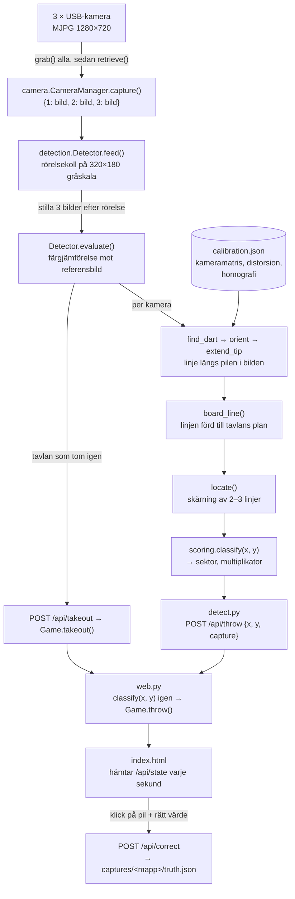

# Systembeskrivning – automatisk dartpoängräkning

Teknisk sammanfattning av vad koden gör, skriven utifrån källkoden per 2026-11-14. Alla tal och namn nedan är de som står i koden; konstantnamn anges inom `kod`.

## Översikt

En Raspberry Pi 4 med tre USB-kameror runt tavlan ser varje pil. När en pil har landat jämförs bilderna med hur tavlan såg ut innan. I varje kamera passas en linje längs pilen. Linjerna förs över till tavlans plan med kalibreringen, och där de skär varandra sitter spetsen. Positionen översätts till sektor och multiplikator och skickas till en webbserver som räknar X01 och visar resultattavlan i webbläsaren.

Tre program körs:

| Program | Roll | Port |
|---|---|---|
| `web_server.py` | Resultattavla och spellogik (systemd-tjänsten `dart-scoreboard`) | 8000 |
| `detect.py` | Pilavkänning, skickar pilar till resultattavlan | – |
| `calibrate.py` | Kalibreringsverktyg, används när en kamera flyttats | 8001 |

`detect.py` och `calibrate.py` håller båda kamerorna och kan inte köras samtidigt.

## 1. Arkitektur

### Moduler och filer

**Paketet `dart_scoring/`**

| Fil | Vad den gör |
|---|---|
| `camera.py` | `CameraManager` öppnar de tre kamerorna via fasta sökvägar under `/dev/v4l/by-path/` (`CAMERA_PATHS`), så kamera-id 1–3 är knutna till USB-hubbens portar 2–4, inte till `/dev/videoN`. `configure()` ställer in MJPG 1280×720 i 30 bilder/s, manuell exponering 20 ms (`EXPOSURE = 200` i enheter om 100 µs, en multipel av 10 ms mot LED-flimmer på 50 Hz), förstärkning 0 och automatisk vitbalans. `capture()` anropar först `grab()` på alla kameror och sedan `retrieve()`, så att de tre bilderna tas så samtidigt som möjligt. |
| `calibration.py` | Kameramodell per kamera: bildpixel → normaliserade tavelkoordinater. Passning från klickade referenspunkter (linsdistorsion + homografi), avbildning åt båda hållen (`image_to_board`, `board_to_image`), ritning av tavlan över en bild, hitta felklickade punkter (`find_suspects`), läsa/skriva `calibration.json`. |
| `calibration_web.py` + `static/calibrate.html` | Webbgränssnittet för kalibreringen: tar bilder från kamerorna, visar live-MJPEG (640×360), tar emot klickade punkter, passar modellen och sparar. |
| `detection.py` | Pilavkänningen: tillståndsmaskinen `Detector` (rörelse → stillhet → utvärdering), bildjämförelse, linjepassning per kamera, sammanvägning av kamerorna till en punkt på tavlan, och debugbilder (`draw_event`). |
| `scoring.py` | `classify(x, y)`: punkt i tavelkoordinater → (sektor, multiplikator). `SEGMENTS` är sektorernas ordning medurs från 20. |
| `game.py` | X01-regler (`Game`): spelare, turer om 3 pilar, bust, double out, rättning av en pil, utdragning, ångra. |
| `web.py` + `static/index.html` | HTTP-server (enbart standardbiblioteket) med ett delat `Game` bakom ett lås, JSON-API och resultattavlan som en sida i ren HTML/JS som hämtar `/api/state` varje sekund. |

**Skript i roten**

| Fil | Vad den gör |
|---|---|
| `detect.py` | Huvudloop för avkänningen: läser kalibreringen, öppnar kamerorna, kastar 15 bilder medan exponeringen sätter sig, tar nästa bild som tom tavla och matar sedan `Detector.feed()` med varje bilduppsättning. Pilar skickas till `/api/throw`, utdragning till `/api/takeout`. Med `--save` sparas före/efter/debugbilder och `event.json` per händelse i `captures/`. |
| `calibrate.py` | Startar kalibreringsverktyget. |
| `web_server.py` | Startar resultattavlan, med loggning till fil som roteras vid 1 MB. |
| `evaluate_captures.py` | Kör nuvarande avkänningskod på sparade bilder för pilar som rättats på resultattavlan (de har en `truth.json`) och räknar hur många som blir rätt. |
| `main.py` | Skriver ut poängen för några hårdkodade punkter (ingen hårdvara behövs). |
| `test_camera.py`, `test_cameras.py` | Manuella hårdvarutester som tar en bild från en respektive alla kameror. |
| `systemd/dart-scoreboard.service` | systemd-användartjänst som startar `web_server.py` vid uppstart och startar om den om den kraschar. |
| `tests/` | Enhetstester (pytest). Avkänningstesterna använder tre syntetiska vidvinkelkameror och renderade pilar. |

### Dataflöde från kamerorna till poängen

Koordinatsystemet på tavlan är normaliserat: origo i bullen, radie 1,0 = ytterkanten på dubbelringen (170 mm), negativ y uppåt mot 20.

`detect.py` skickar koordinaterna, inte poängen; resultattavlan klassificerar själv med samma `classify`. Om resultattavlan inte svarar inom 3 s loggas en varning och pilen går förlorad för spelet (den finns kvar i loggen).

## 2. Externa bibliotek

Projektet har ingen `requirements.txt`; allt installeras som Debian-paket i systemets Python (ingen virtualenv). Versioner enligt `dpkg` och modulernas `__version__` på Pi:n:

| Bibliotek | Version | Används till |
|---|---|---|
| Python | 3.13.5 | Körmiljö |
| OpenCV (`cv2`, paketet `python3-opencv`) | 4.10.0 | Kamerainläsning via V4L2 (`VideoCapture`, MJPG-avkodning); bildbehandling (`GaussianBlur`, `resize`, `absdiff`, `subtract`, `dilate`/`erode`, `threshold`, `morphologyEx`, `connectedComponentsWithStats`, `fitLine`, `fillPoly`); kalibrering (`calibrateCamera`, `findHomography`, `undistortPointsIter`, `projectPoints`, `perspectiveTransform`); JPEG-kodning för sparade bilder och kalibreringsverktygets ström; ritning av debugbilder |
| NumPy (`python3-numpy`) | 2.2.4 | Matriser och vektorräkning: linjer, minsta kvadrat-skärning (`linalg.lstsq`), Jacobian och SVD för mm per pixel, kameraposition ur homografin |
| pytest (`python3-pytest`) | 8.3.5 | Endast enhetstesterna |

Från standardbiblioteket: `http.server` (`ThreadingHTTPServer`) för båda webbservrarna, `urllib.request` för anropen från `detect.py` till resultattavlan, `json`, `threading`, `logging` (med `RotatingFileHandler`), `argparse`, `dataclasses`, `copy` (ångra-historiken), `re`, `math`, `pathlib`, `datetime`.

Webbsidorna laddar inga externa skript eller stilmallar.

## 3. Hur träffpunkten detekteras

### 3.1 Kalibrering

Kalibreringen görs en gång per kamera i `calibrate.py` och sparas i `calibration.json`.

1. Användaren klickar referenspunkter i varje kameras bild: där en ringkant (`RINGS`: dubbel ytter/inner, trippel ytter/inner, yttre bull, bullseye) korsar en sektorgränstråd (gräns 0–19, 0 = tråden mellan 20 och 1), eller bullens mitt. Varje etikett har en känd position på tavlan (`reference_point`), vinkel `9 + 18·gräns` grader medurs från 20.
2. `fit()`, med minst 12 punkter (`MIN_DISTORTION_POINTS`): `cv2.calibrateCamera` med tavelpunkterna som ett plant objekt (z = 0) i en enda vy. Startgissning brännvidd 0,8 × bildbredden, huvudpunkten i bildens mitt. Flaggor: startgissning används, fast bildförhållande, ingen tangentiell distorsion, k3 = 0. Kvar blir kameramatrisen och radiell distorsion k1, k2 (vidvinkellinserna har k1 ≈ −0,47).
3. De klickade pixlarna avdistorderas (`cv2.undistortPointsIter`, 50 iterationer) och en homografi passas med `cv2.findHomography` (vanlig minsta kvadrat, ingen RANSAC) från avdistorderade normaliserade bildkoordinater till tavelkoordinater.
4. Med 4–11 punkter passas bara en homografi direkt på pixlar. Under 4 punkter sparas bara punkterna.
5. Restfel per punkt räknas både i mm på tavlan och i pixlar och visas i verktyget. `find_suspects()` hittar felklickade punkter: varje punkt kontrolleras mot en modell passad utan den, och missar den med mer än max(20 px, 3 × medianmissen) kontrolleras den igen mot en modell utan alla sådana kandidater. Verktyget föreslår den etikett som modellen lägger närmast klicket.

`image_to_board(modell, u, v)` = avdistordera pixeln, tillämpa homografin. `board_to_image` gör det omvända.

### 3.2 Bildbehandling per kamera

När en utvärdering körs (se avsnitt 4) gör `Detector.evaluate()` följande för varje kamera:

1. **Utjämning:** färgbilden suddas med Gauss 5×5 (`to_blurred`). Jämförelsen sker i färg och inte gråskala, eftersom stålspetsen över den gröna ringen är ungefär lika ljus som det gröna.
2. **Ändringsmask** (`change_mask`) mot referensbilden (tavlan efter förra händelsen):
   - För att tåla att kameran skakar vid träffen räknas en pixel bara som ändrad om den ligger utanför spannet av referensbildens värden inom `SHIFT_PX = 2` pixlar: `max(efter − dilate(före), erode(före) − efter)` med en 5×5-kärna, per färgkanal.
   - Största ändringen av de tre kanalerna tas, tröskel `> 25` (`CHANGE_PIXEL`).
   - Masken begränsas till området där en pil kan synas (`board_mask`): en cirkel med radie 1,2 (204 mm) förd in i bilden med kalibreringen, utökad 320 pixlar uppåt (`MASK_UP_PX`) för skaft och fjädrar.
   - Morfologisk öppning 3×3 (tar bort brus) och stängning 7×7 (fyller hål).
3. **Linje längs pilen** (`find_dart`):
   - Sammanhängande områden mindre än 25 pixlar (`MIN_COMPONENT`) kastas. Är färre än 150 pixlar kvar (`MIN_DART_PIXELS`) ser kameran ingen pil.
   - Högst 20 000 pixlar (slumpvis urval) används. En linje passas med `cv2.fitLine` (Huber), pixlar längre än 30 px från linjen (`REFINE_PX`) tas bort och linjen passas om; detta görs två gånger.
   - Linjens riktning vänds så att den pekar nedåt i bilden. Längs linjen klipps upp till 0,5 % av pixlarna, men högst 15 (`TIP_TRIM_PIXELS`), bort i varje ände mot ströpixlar. Nedre änden blir den synliga spetsen, övre änden toppen.
   - Förhållandet längd/bredd (bredd = 2 × 95:e percentilen av avståndet från linjen) måste vara minst 2,5 (`MIN_ELONGATION`), annars är det inte en pil.
4. **Riktningskontroll** (`orient`): ur homografin räknas kamerans läge relativt tavlan ut (`camera_pose`), och därmed åt vilket håll i bilden en pil som sticker rakt ut ur tavlan vid spetsen pekar (`dart_axis`, mätt mellan tavlan och 0,2 radier = 34 mm ut). Avviker linjen mer än 35° (`MAX_AXIS_ANGLE`) från den riktningen räknas kameran bort. Pekar linjen åt fel håll byts spets och topp.
5. **Förlängning av spetsen** (`extend_tip`): ändringsmasken med skaktolerans tappar ofta den tunna spetsen där den korsar en tråd eller en färggräns. Från spetsen följs linjen upp till 30 pixlar längre (`TIP_SEARCH_PX`) i en remsa ±4 pixlar bred, med vanlig färgskillnad utan skaktolerans. Spetsen flyttas till sista steget där skillnaden är `> 25`; upp till 3 steg i rad utan skillnad (`TIP_SEARCH_GAP`) tolereras.

### 3.3 Linjen på tavlans plan

Pilens linje i en kameras bild ligger i ett plan genom kameran och pilen. Det planet skär tavlan längs en linje som går genom punkten där pilen sitter, även om själva spetsen inte syns. `board_line()` för över:

- **punkt:** den synliga spetsen, avbildad på tavlan;
- **riktning:** från spetsen mot pilens mittpunkt, avbildad på tavlan (mitten och inte toppen, eftersom toppen på en pil långt bort kan hamna ovanför tavelplanets horisont i bilden);
- **skärpa:** `mm_per_pixel`, hur många mm på tavlan en pixel täcker vid spetsen, i sin grövsta riktning (största singulärvärdet av avbildningens Jacobian).

### 3.4 Hur de tre kamerorna kombineras (`locate`)

Indata är en linje per kamera som såg pilen.

1. **Alla tre linjerna:** om tre linjer finns och största vinkeln mellan två av dem är minst 12° (`MIN_LINE_ANGLE`) beräknas en minsta kvadrat-skärning. Ligger alla tre linjerna inom 8 mm (`LINE_TOLERANCE_MM`) från punkten används den (metod "skärning 1+2+3").
2. **Bästa paret:** annars prövas varje par av linjer som möts med minst 12°. Paret vars skärning ligger närmast den bästa synliga spetsen (`best_tip`) väljs, om skärningen ligger högst 40 mm därifrån (`MAX_TIP_OFFSET_MM`).
   - Bästa synliga spets: med en eller två kameror ett medelvärde viktat med 1/(mm per pixel)², så den kamera som ser skarpast väger tyngst; med tre kameror den spets som har minst sammanlagt avstånd till de andra.
   - **Skarp-spets-regeln:** möts paret med under 20° (`SHARP_TIP_ANGLE`), ser den ena kameran minst 3 gånger skarpare (`SHARP_TIP_RATIO`) och hamnar skärningen bakom den skarpa kamerans synliga spets (på skaftets sida, där spetsen inte kan vara) används den skarpa kamerans spets i stället (metod "spets N"). Framför spetsen accepteras skärningen, eftersom den tunna spetsen ofta inte syns mot tavlan.
3. **Ingen användbar skärning:** den bästa synliga spetsen används direkt (metod "spets …"). Så blir det också när bara en kamera såg pilen.

I alla skärningar drar dessutom varje kameras synliga spets svagt i punkten: en extra ekvation per kamera med vikten 0,02 × (0,5 / mm per pixel)² (`TIP_WEIGHT`, `TIP_REFERENCE_MM_PER_PX`). Den spelar bara roll längs nästan parallella linjer, där skärningen är dåligt bestämd, och då avgör den kamera som är närmast pilen.

Ligger resultatet längre än 1,35 radier (230 mm, `MAX_RADIUS`) från mitten räknas händelsen som oklar; där kan ingen pil sitta.

### 3.5 Från position till sektor och poäng (`scoring.classify`)

Med r = avståndet från mitten (normaliserat, ringmått i mm / 170):

| Villkor | Resultat |
|---|---|
| r > 1,0 | Miss (0, 0) |
| r ≤ 6,35/170 | Bullseye (25, ×2) = 50 |
| r ≤ 15,9/170 | Yttre bull (25, ×1) = 25 |
| 99/170 ≤ r ≤ 107/170 | Trippel |
| 162/170 ≤ r ≤ 1,0 | Dubbel |
| annars | Singel |

Sektorn: vinkeln medurs från 20, `atan2(x, −y)` i grader, ger index `⌊(vinkel + 9) / 18⌋ mod 20` i `SEGMENTS = [20, 1, 18, 4, 13, 6, 10, 15, 2, 17, 3, 19, 7, 16, 8, 11, 14, 9, 12, 5]`. Poängen är sektor × multiplikator.

## 4. Ny pil och utdragning

### 4.1 Tillstånd i `Detector`

| Fält | Betydelse |
|---|---|
| `reference` | Utjämnad bild per kamera av tavlan efter senaste händelsen |
| `empty` | Utjämnad bild per kamera av den tomma tavlan |
| `empty_change` | Antal ändrade pixlar mot den tomma tavlan efter senaste händelsen |
| `moving`, `still` | Om rörelse setts sedan senaste utvärderingen, och antal stilla bilder i rad |
| `darts` | Pilar i tavlan sedan senaste utdragningen |
| `last_event_time` | Tid för senaste utvärdering eller uppdatering av referensen |

När `detect.py` startar tas en bilduppsättning som både referens och tom tavla (`reset`), så tavlan måste vara tom då.

### 4.2 Rörelse och stillhet (`feed`, varje bilduppsättning)

1. Varje bild skalas ned till 320×180 gråskala och suddas med Gauss 3×3.
2. Absolut skillnad mot föregående nedskalade bild, inom tavelmasken. En pixel med skillnad `> 15` (`MOTION_PIXEL`) räknas som rörelse. Rör sig mer än 0,2 % av maskens pixlar (`MOTION_FRACTION`) i någon kamera är det rörelse.
3. Rörelse: `moving = True`, `still = 0`.
4. Ingen rörelse: `still` ökas. Har det rört sig och varit stilla 3 bilder i rad (`STILL_FRAMES`) körs `evaluate()`. Avkänningen hinner med ungefär 8 bilduppsättningar per sekund (MJPG-avkodningen av tre bilder tar ~38 ms), så det motsvarar ungefär 0,4 s stillhet.
5. Har ingenting rört sig och det gått mer än 10 s (`REFRESH_SECONDS`) sedan senaste händelsen uppdateras referensen (`_refresh`), om ingen kamera har 150 eller fler ändrade pixlar mot den. Så följer avkänningen långsamma ljusförändringar. Är tavlan tom (`darts == 0`) uppdateras även den tomma tavlan.

### 4.3 Utvärdering (`evaluate`)

Ändringsmasken (avsnitt 3.2) räknas mot referensen per kamera och mot den tomma tavlan summerat över kamerorna. Besluten tas i den här ordningen:

| Steg | Villkor | Händelse | Följd |
|---|---|---|---|
| 1 | Färre än 150 ändrade pixlar i varje kamera | `none` | Ingenting; referensen behålls (t.ex. en hand som rörde sig och försvann) |
| 2 | Pilar finns och ändringen mot tomma tavlan är under 150 × antal kameror (450), eller under 10 % (`TAKEOUT_SHARE`) av vad den var med pilarna i | `takeout` | `darts = 0`, den tomma tavlan tas om; `detect.py` skickar `/api/takeout` |
| 3 | Pilar finns och ändringen mot tomma tavlan har minskat med mer än hälften av ändringen mot referensen | `removed` | En pil drogs ut; `darts` minskas, inget skickas |
| 4 | Någon kamera har mer än 5 % av bilden ändrad (`MAX_DART_FRACTION`, 46 080 pixlar) | `unclear` | Inte en enskild pil (t.ex. en person framför tavlan); inget skickas |
| 5 | Ingen kamera ger en godkänd linje, eller punkten ligger utanför 1,35 radier | `unclear` | Inget skickas |
| 6 | Annars | `dart` | Position och poäng räknas ut, `darts` ökas, `detect.py` skickar `/api/throw` |

Vid alla händelser utom `none` blir de nya bilderna referens, så nästa pil jämförs med tavlan inklusive tidigare pilar.

### 4.4 Spellogiken vid kast och utdragning (`game.py`)

- `throw()`: är förra turen slut (3 pilar eller bust) går turen först över till nästa spelare. Pilen dras av; under 0, exakt 1 med double out, eller 0 på något annat än en dubbel med double out ger bust och poängen återställs till turens början. Bullseye räknas som dubbel.
- `takeout()`: har turen påbörjats men inte avslutats fylls den upp med missar (pilar som missade tavlan syns aldrig för avkänningen). Turen visas tills nästa pil kastas.
- `correct()`: ändrar en pil i turen som visas och räknar om turen från början. För en avkänd pil skriver servern `truth.json` (rätt värde och vad avkänningen sa) i pilens mapp under `captures/`, om `detect.py` körs med `--save`.

## 5. Konfigurationsparametrar

Allt utom kommandoradsflaggorna är konstanter i koden; det finns ingen separat konfigurationsfil utöver `calibration.json`.

### Kommandorad

| Program | Flagga | Standard |
|---|---|---|
| `detect.py` | `--server` | `http://localhost:8000` |
| | `--dry-run` | av (skicka inget, bara logga) |
| | `--save` | av (spara bilder per händelse i `captures/`) |
| | `--calibration` | `calibration.json` i repots rot |
| | `--log-file` | `logs/detect.log` |
| `web_server.py` | `--host`, `--port`, `--log-file` | `0.0.0.0`, 8000, ingen (tjänsten använder `logs/web_server.log`) |
| `calibrate.py` | `--host`, `--port`, `--file` | `0.0.0.0`, 8001, `calibration.json` |
| `evaluate_captures.py` | `--all`, `--captures`, `--calibration` | av, `captures/`, `calibration.json` |

Loggfiler roteras vid 1 MB med 3 säkerhetskopior.

### Kameror (`camera.py`)

| Parameter | Värde |
|---|---|
| `CAMERA_PATHS` | USB-sökväg per kamera-id (hubbens portar 1.1.2, 1.1.3, 1.1.4) |
| Format | MJPG, 1280×720, 30 bilder/s |
| `EXPOSURE` | 200 (= 20 ms), manuell; förstärkning 0; automatisk vitbalans |
| Insvängning | 15 bilder kastas efter start (`detect.py`, `SETTLE_FRAMES` i kalibreringsverktyget) |

### Kalibrering (`calibration.py`, `calibration_web.py`)

| Parameter | Värde | Betydelse |
|---|---|---|
| `BOARD_RADIUS_MM` | 170 | Normaliseringsradie |
| `RINGS` | 170, 162, 107, 99, 15,9, 6,35 mm (/170) | Ringkanter |
| `MIN_POINTS` | 4 | Minsta antal punkter för en modell |
| `MIN_DISTORTION_POINTS` | 12 | Från detta antal skattas linsdistorsion |
| `SUSPECT_PX`, `SUSPECT_FACTOR` | 20 px, 3 | Gräns för misstänkt felklick |
| `STREAM_SIZE`, `STREAM_INTERVAL_S` | 640×360, 0,1 s | Live-ström i verktyget |
| `LIVE_IDLE_CLOSE_S` | 3 s | Kamerorna stängs så länge efter sista tittaren |

### Avkänning (`detection.py`)

| Parameter | Värde | Betydelse |
|---|---|---|
| `SMALL_SIZE` | 320×180 | Bildstorlek för rörelsekollen |
| `MOTION_PIXEL` | 15 | Gråskaleskillnad som räknas som rörelse |
| `MOTION_FRACTION` | 0,002 | Andel av maskens pixlar för rörelse |
| `STILL_FRAMES` | 3 | Stilla bilder i rad innan utvärdering |
| `CHANGE_PIXEL` | 25 | Färgskillnad som räknas som ändring |
| `SHIFT_PX` | 2 | Tolererad bildförskjutning (skakning) |
| `MIN_COMPONENT` | 25 | Minsta område som räknas |
| `MIN_DART_PIXELS` | 150 | Minsta ändring per kamera för en pil; även gräns för `none` och utdragning |
| `MAX_DART_FRACTION` | 0,05 | Större ändring än så: inte en pil |
| `MIN_ELONGATION` | 2,5 | Minsta längd/bredd |
| `REFINE_PX` | 30 | Pixlar närmare linjen än så behålls vid ompassning |
| `TIP_PERCENTILE`, `TIP_TRIM_PIXELS` | 99,5, 15 | Klippning av ändarna |
| `TIP_SEARCH_PX`, `TIP_SEARCH_GAP`, `TIP_SEARCH_HALF_WIDTH` | 30, 3, 4 | Förlängning av spetsen |
| `MASK_RADIUS`, `MASK_UP_PX` | 1,2, 320 px | Område där en pil kan synas |
| `MAX_AXIS_ANGLE`, `AXIS_HEIGHT` | 35°, 0,2 | Riktningskontroll mot tavlans normal |
| `MIN_LINE_ANGLE` | 12° | Minsta vinkel för en skärning |
| `LINE_TOLERANCE_MM` | 8 mm | Max avstånd för att alla tre linjerna ska godtas |
| `MAX_TIP_OFFSET_MM` | 40 mm | Max avstånd mellan skärning och synlig spets |
| `TIP_WEIGHT`, `TIP_REFERENCE_MM_PER_PX` | 0,02, 0,5 | Hur mycket synliga spetsar drar i skärningen |
| `SHARP_TIP_ANGLE`, `SHARP_TIP_RATIO` | 20°, 3 | Skarp-spets-regeln |
| `MAX_RADIUS` | 1,35 | Längst ut en pil kan sitta |
| `TAKEOUT_SHARE` | 0,1 | Gräns för utdragning |
| `REFRESH_SECONDS` | 10 s | Uppdatering av referens vid stillhet |

### Spel och webbserver (`game.py`, `web.py`)

| Parameter | Värde |
|---|---|
| `DARTS_PER_TURN` | 3 |
| Nytt spel (`/api/new-game`) | spelare, startpoäng (standard 501, minst 2), double out (standard på) |
| Spel vid serverstart | "Spelare 1", "Spelare 2", 501, double out |
| `MAX_BODY` | 64 kB per förfrågan (256 kB i kalibreringsverktyget) |
| Uppdatering av sidan | `/api/state` varje sekund |
| Timeout för `detect.py` → resultattavlan | 3 s |

Spelet hålls bara i minnet och nollställs när tjänsten startas om.
